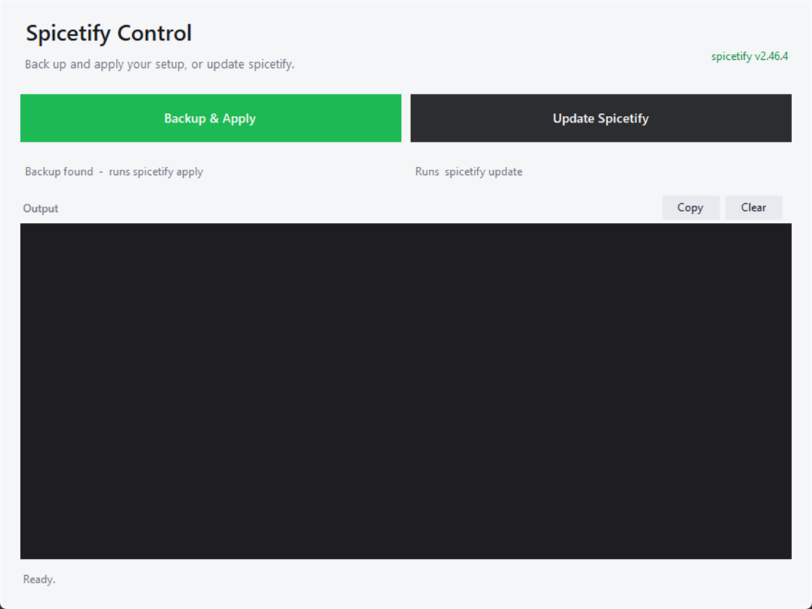

# Spicetify Manager

[](LICENSE)

A small Windows GUI for [spicetify](https://spicetify.app) — install spicetify, back up and apply your setup, and update the CLI without remembering commands.



## Features

- **Install Spicetify** — if spicetify isn't found, the GUI offers to run the official installer (`install.ps1`) for you, then picks it up automatically.
- **Backup & Apply** — runs `spicetify backup apply` when there is no backup yet, and `spicetify apply` when one already exists (so it never fails on an existing backup).
- **Update Spicetify** — runs `spicetify update`.
- Live, colour-coded command output with ANSI codes stripped; **Stop**, **Copy** and **Clear**.
- Detects the installed version, the spicetify location, and whether a backup exists.
- Single self-contained executable: no setup program, no config files, no runtime files next to it.

## Requirements

- Windows 10 or 11 (the .NET Framework 4.x runtime is included with Windows).
- [spicetify](https://spicetify.app) installed — or let the GUI install it (needs an internet connection). It is found via `PATH`, `%LOCALAPPDATA%\spicetify` or `%APPDATA%\spicetify`.
- Spotify installed, as required by spicetify.

## Download and run

1. Download `SpicetifyGui.exe` from the [latest release](https://github.com/adithya-s-119/spicetify-manager/releases/latest) (it is also committed in this repository).
2. Double-click it.

The executable is standalone — you can move it anywhere and delete every other file. You can also pass spicetify arguments to run them on launch:

```powershell
.\SpicetifyGui.exe update
.\SpicetifyGui.exe --version
```

## Installing spicetify

If spicetify isn't installed, the version label in the top-right corner is replaced by an **Install Spicetify** button. It runs the official installer:

```powershell
iwr -useb https://raw.githubusercontent.com/spicetify/cli/main/install.ps1 | iex
```

That installer is interactive (it asks about the Marketplace and can repair an existing install), so it opens in its own console window — answer its prompts there. When it closes, the GUI re-checks for spicetify and enables the action buttons automatically. It installs to `%LOCALAPPDATA%\spicetify` and adds that folder to your user `PATH`.

## How "Backup & Apply" decides

`spicetify backup` creates exactly one backup and refuses to overwrite it, so the button checks first:

| State | What it runs |
| --- | --- |
| No backup found in `%APPDATA%\spicetify\Backup` | `spicetify backup apply` |
| A backup already exists | `spicetify apply` |

That means the same button works on a fresh install and on an already-patched Spotify, without ever hitting the "backup already exists" error.

To deliberately start over, run `spicetify restore backup apply` in a terminal: it restores Spotify's stock files, captures a fresh backup, then re-applies your setup.

## Console launcher

`SpicetifyApply.exe` is a minimal console alternative. It runs `spicetify backup apply` by default and passes arguments through:

```powershell
.\SpicetifyApply.exe              # spicetify backup apply
.\SpicetifyApply.exe apply        # spicetify apply
.\SpicetifyApply.exe --version --no-pause
```

`--no-pause` skips the final "press any key" prompt, which is useful in scripts.

## Build from source

Both programs are plain C# compiled with the C# compiler that ships with the .NET Framework. From the repository root:

```powershell
.\build.ps1
```

Or manually:

```powershell
$csc = "$env:WINDIR\Microsoft.NET\Framework64\v4.0.30319\csc.exe"

& $csc /nologo /target:winexe /platform:anycpu /optimize+ /win32icon:SpicetifyGui.ico `
  /out:SpicetifyGui.exe `
  /r:System.dll /r:System.Core.dll /r:System.Drawing.dll /r:System.Windows.Forms.dll `
  SpicetifyGui.cs

& $csc /nologo /target:exe /platform:anycpu /optimize+ /win32icon:SpicetifyGui.ico `
  /out:SpicetifyApply.exe SpicetifyApply.cs
```

## Code signing

The current release is unsigned, so Windows SmartScreen shows *"Unknown publisher"* the first time you run it — choose **More info → Run anyway**, or build it yourself from the sources above.

The project is applying for free code signing through the [SignPath Foundation](https://signpath.org), which signs open-source Windows builds at no cost. Once approved, releases will be signed and can be verified with:

```powershell
signtool verify /pa /v SpicetifyGui.exe
```

Until then you can always check that a download matches the source: every release is built by the [`build` workflow](.github/workflows/build.yml) on GitHub, and the same `build.ps1` is in this repository. See [SIGNING.md](SIGNING.md) for the full signing policy.

## Repository layout

| File | Purpose |
| --- | --- |
| `SpicetifyGui.exe` | The GUI application (prebuilt). |
| `SpicetifyGui.cs` | WinForms source for the GUI. |
| `SpicetifyGui.ico` | Application icon. |
| `SpicetifyApply.exe` | Console launcher (prebuilt). |
| `SpicetifyApply.cs` | Console launcher source. |
| `build.ps1` | Rebuilds both executables. |
| `.github/workflows/build.yml` | CI build (and the SignPath signing step, once enabled). |
| `SIGNING.md` | Code signing policy. |
| `docs/screenshot.png` | Screenshot used in this README. |
| `LICENSE` | MIT license. |

## License

[MIT](LICENSE) © 2026 Adithya S

## Disclaimer

Unofficial tool. Not affiliated with spicetify or Spotify.
